# 🥧 Empadas da Bia — Sistema de Gerenciamento

Sistema desktop em **Java Swing** para a Empadas da Bia, uma pequena empresa que vende empadas.
Ele cadastra categorias, produtos (com foto) e clientes e registra pedidos com vários itens.
O total de cada pedido é calculado automaticamente.

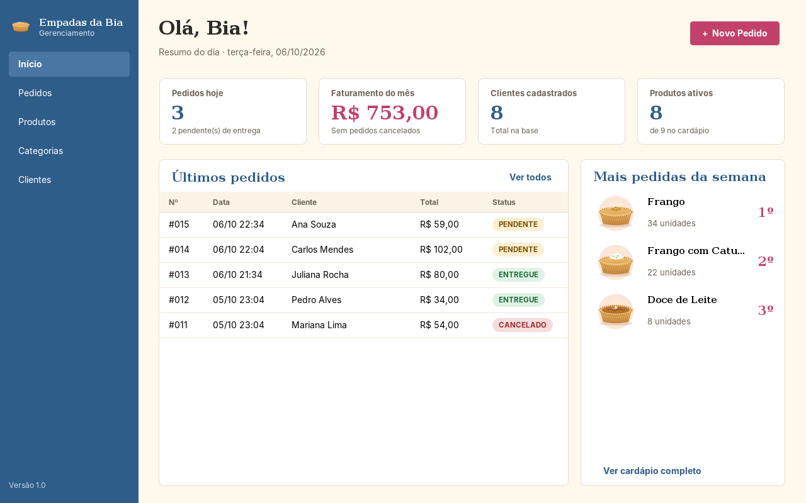

---

## 📌 Informações acadêmicas

| | |
|---|---|
| **Instituição** | UNIVILLE – Universidade da Região de Joinville |
| **Curso** | [Nome do curso] |
| **Disciplina** | [Nome da disciplina] |
| **Professor(a)** | [Nome do professor] |
| **Atividade** | Sistema Desktop com Java Swing |
| **Ano/Semestre** | 2026 / 2º semestre |

### Integrantes

- [Nome do integrante 1]
- [Nome do integrante 2]

---

## 🎯 Objetivo

Oferecer um sistema simples e profissional para a empresa:

- manter o **cardápio** (categorias e produtos com foto e preço);
- manter o cadastro de **clientes** com endereço de entrega;
- **registrar pedidos** de forma rápida, com o total calculado a partir dos itens;
- acompanhar os pedidos (pendente, entregue ou cancelado) e os números do dia.

## ✅ Funcionalidades

| Módulo | O que faz |
|---|---|
| **Início (Dashboard)** | Pedidos do dia, faturamento do mês, total de clientes, produtos ativos, últimos pedidos e as 3 empadas mais pedidas da semana |
| **Produtos (Cardápio)** | Cartões com foto agrupados por categoria, filtro por categoria e busca por nome. Cadastrar, editar (com escolha de imagem), ativar/desativar e excluir |
| **Categorias** | Cadastrar, editar, excluir e listar (com a quantidade de produtos de cada uma) |
| **Clientes** | Cadastrar, editar, excluir, listar e buscar por nome ou telefone |
| **Pedidos** | Listar com filtro por cliente e status, ver detalhes, marcar como entregue ou cancelar |
| **Novo Pedido** | Cardápio à esquerda e comanda à direita: escolher o cliente, adicionar produtos, ajustar quantidades, ver subtotais e total, revisar e confirmar |

### Regras de negócio

- O nome da categoria é único. Uma categoria **com produtos não pode ser excluída**.
- O preço do produto precisa ser maior que zero. Um produto que já aparece em pedidos **não pode ser excluído**: ele é **desativado** e sai do cardápio de novos pedidos.
- O cliente precisa de nome e telefone (com DDD). E-mail e CEP são opcionais, mas validados quando informados. Um cliente com pedidos não pode ser excluído.
- O pedido exige um cliente e pelo menos um item. Se o mesmo produto for adicionado duas vezes, as quantidades são somadas.
- O item guarda o **preço unitário do momento da venda**.
- Pedidos não são apagados, apenas **cancelados**, para manter o histórico. Somente pedidos **pendentes** podem mudar de status.
- O pedido e seus itens são gravados em uma **transação**: ou grava tudo, ou nada.

---

## 🛠️ Tecnologias

| Tecnologia | Uso |
|---|---|
| **Java 25** | Linguagem (funciona com Java 21 ou superior) |
| **Java Swing** | Interface gráfica |
| **MySQL 8** | Banco de dados |
| **JDBC** + `PreparedStatement` | Acesso ao banco, sem SQL concatenado |
| **Maven** | Baixa as dependências e gera o `.jar` |
| **FlatLaf** | Visual moderno para o Swing (única biblioteca visual) |
| **JUnit 5** | Testes automatizados das regras (apenas nos testes) |

---

## 🧱 Arquitetura MVC

```
 VIEW (telas Swing)  ──ação do usuário──▶  CONTROLLER  ──▶  DAO  ──JDBC──▶  MySQL
        ▲                                     │             ▲
        └────── dados / mensagens ────────────┘             │
                          MODEL (entidades e regras) ───────┘
```

| Camada | Pacote | Responsabilidade |
|---|---|---|
| **Model** | `model` | Entidades (`Cliente`, `Produto`, `Pedido`...) e regras próprias delas, como `Pedido.calcularTotal()` |
| **View** | `view` | Telas Swing. Só exibem dados e capturam as ações; **não contêm SQL** |
| **Controller** | `controller` | Recebe a ação da tela, valida os dados, monta os objetos e chama o DAO |
| **DAO** | `dao` | Todo o SQL do sistema, usando `PreparedStatement` |
| **Database** | `database` | Abre a conexão com o MySQL (lê `database.properties`) |
| **Utils** | `utils` | Validação, formatação (R$, datas, telefone), mensagens, imagens e tema visual |

**Exemplo do caminho de uma ação (salvar produto):**
`DialogProduto` (clique em Salvar) → `ProdutoController.salvar(...)` valida nome e preço → `ProdutoDAO.inserir(produto)` executa o `INSERT` → a tela mostra o resultado ou a mensagem de erro.

---

## 🗄️ Banco de dados

5 tabelas: `categoria`, `produto`, `cliente`, `pedido` e `item_pedido`.

### MER (Modelo Entidade-Relacionamento)

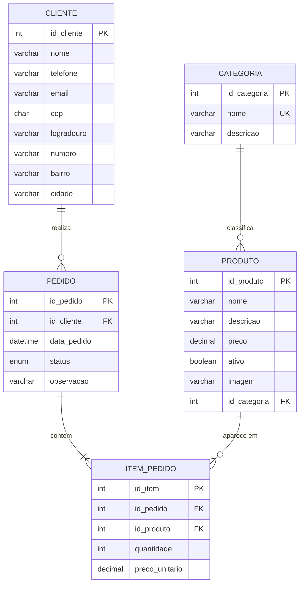

### Estrutura das tabelas

**categoria**

| Campo | Tipo | Restrição |
|---|---|---|
| id_categoria | INT AUTO_INCREMENT | PK |
| nome | VARCHAR(50) | NOT NULL, UNIQUE |
| descricao | VARCHAR(150) | NULL |

**produto**

| Campo | Tipo | Restrição |
|---|---|---|
| id_produto | INT AUTO_INCREMENT | PK |
| nome | VARCHAR(100) | NOT NULL |
| descricao | VARCHAR(255) | NULL |
| preco | DECIMAL(10,2) | NOT NULL, CHECK (preco > 0) |
| ativo | BOOLEAN | NOT NULL, DEFAULT TRUE |
| imagem | VARCHAR(255) | NULL (nome do arquivo da foto) |
| id_categoria | INT | FK → categoria |

**cliente**

| Campo | Tipo | Restrição |
|---|---|---|
| id_cliente | INT AUTO_INCREMENT | PK |
| nome | VARCHAR(100) | NOT NULL |
| telefone | VARCHAR(15) | NOT NULL (só números) |
| email | VARCHAR(100) | NULL |
| cep | CHAR(8) | NULL (só números) |
| logradouro, numero, bairro, cidade | VARCHAR | NULL |

**pedido**

| Campo | Tipo | Restrição |
|---|---|---|
| id_pedido | INT AUTO_INCREMENT | PK |
| id_cliente | INT | FK → cliente |
| data_pedido | DATETIME | NOT NULL |
| status | ENUM('PENDENTE','ENTREGUE','CANCELADO') | NOT NULL |
| observacao | VARCHAR(255) | NULL |

**item_pedido**

| Campo | Tipo | Restrição |
|---|---|---|
| id_item | INT AUTO_INCREMENT | PK |
| id_pedido | INT | FK → pedido (ON DELETE CASCADE) |
| id_produto | INT | FK → produto |
| quantidade | INT | NOT NULL, CHECK (> 0) |
| preco_unitario | DECIMAL(10,2) | NOT NULL |

### Decisões de modelagem

- **`item_pedido`**: um pedido pode ter vários produtos e um produto pode aparecer em vários pedidos (N:N). Essa tabela liga os dois e guarda a quantidade e o preço.
- **`preco_unitario` no item**: o preço do produto pode mudar, mas o pedido antigo precisa manter o valor cobrado.
- **Subtotal e total não são colunas**: eles podem ser calculados a partir dos itens. Guardá-los poderia gerar valores inconsistentes, por isso o banco fica normalizado.
- **Endereço dentro de `cliente`**: cada cliente tem um único endereço, então uma tabela separada só acrescentaria um JOIN.
- **Imagem como nome de arquivo**: o banco guarda só o nome (`empada-frango.png`), e o arquivo fica numa pasta. Assim o banco continua leve.

---

## 📐 Diagrama de classes

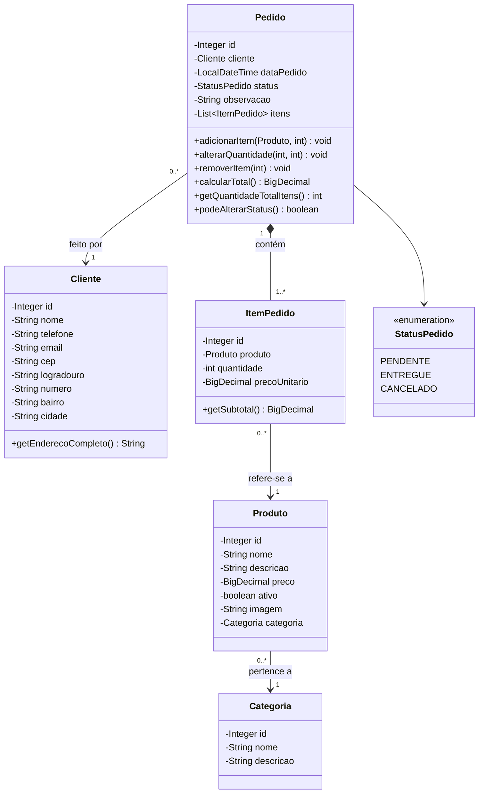

Getters e setters foram omitidos. A relação **Pedido–ItemPedido é uma composição**: o item não existe sem o pedido.

---

## 🖼️ Protótipos e telas

**Protótipos (link):** https://claude.ai/artifact/L1gpKNLaUjhdoEw3ZjTgzd

| | |
|---|---|
|  **1. Tela Principal** | 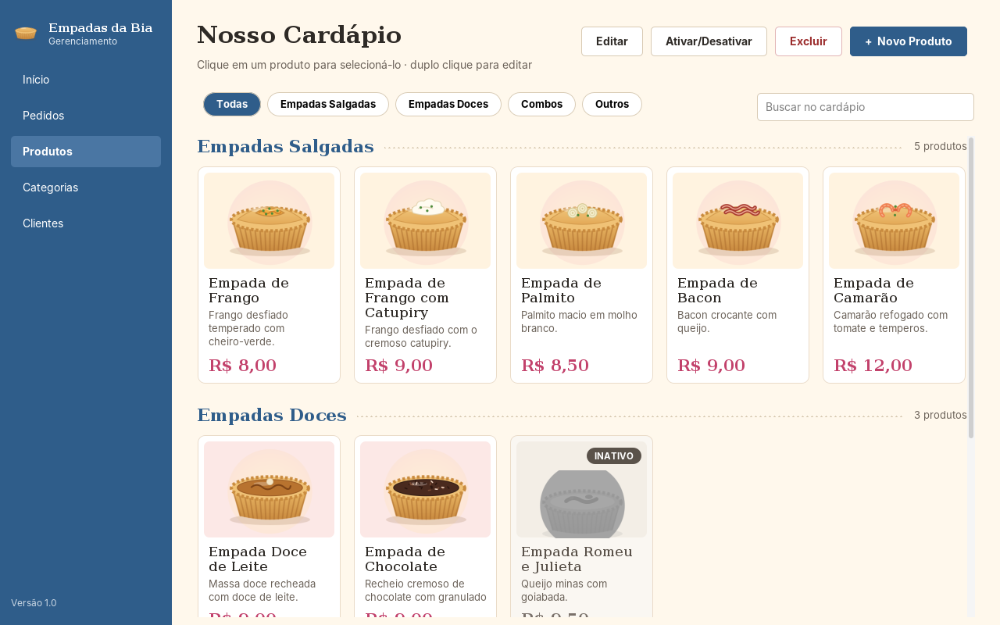 **2. Produtos (Cardápio)** |
| 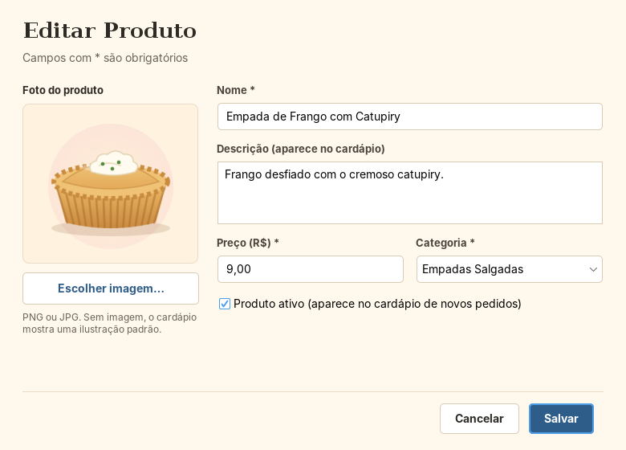 **3. Cadastro/Edição de Produto** | 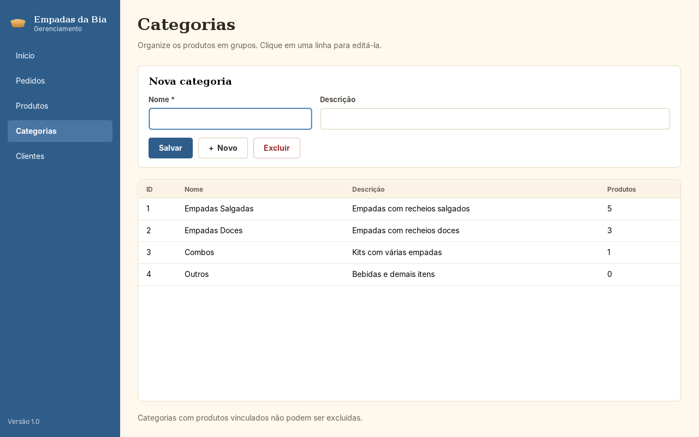 **4. Categorias** |
| 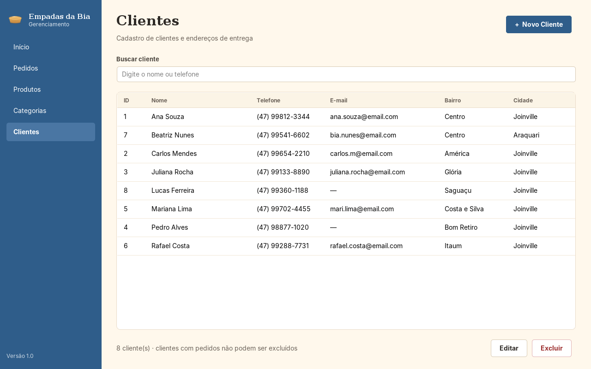 **5. Clientes** | 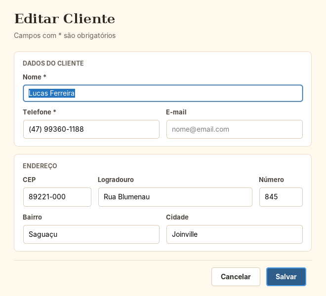 **6. Cadastro/Edição de Cliente** |
| 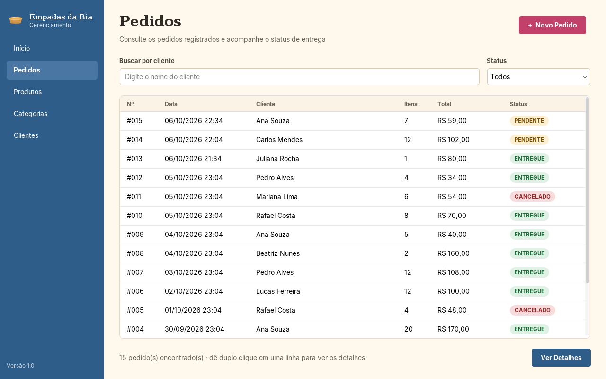 **7. Pedidos** | 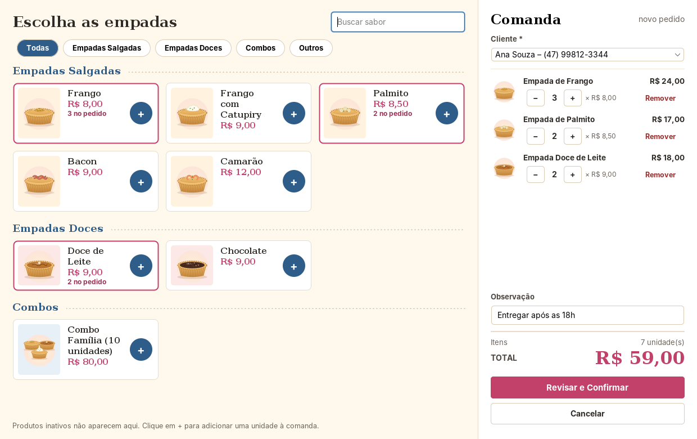 **8. Novo Pedido** |
| 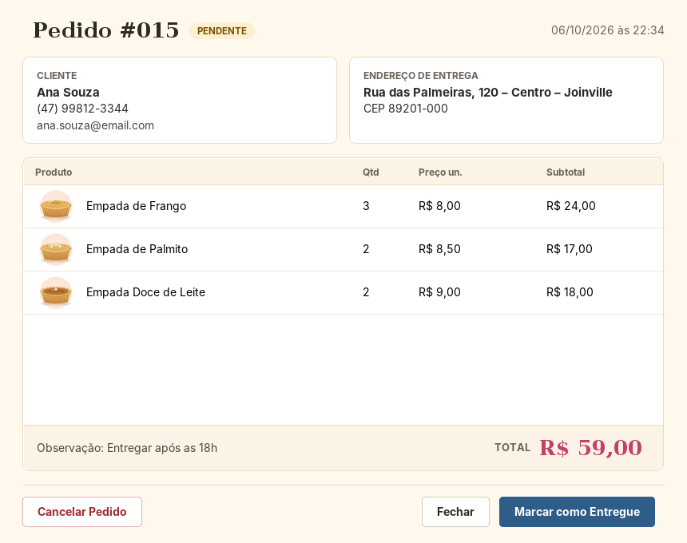 **9. Detalhes do Pedido** | |

### Fluxo do pedido

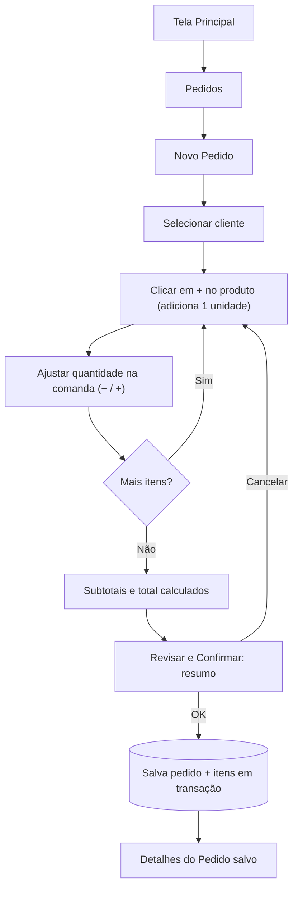

---

## 📁 Estrutura do projeto

```
empadas-da-bia/
├── pom.xml                         Dependências (Maven)
├── README.md
├── database/
│   ├── schema.sql                  Criação do banco e das tabelas
│   └── dados_exemplo.sql           Dados para testes e apresentação
├── docs/
│   ├── telas/                      Capturas das telas
│   └── ROTEIRO_TESTES.md           Testes manuais
└── src/
    ├── main/java/br/com/empadasdabia/
    │   ├── Main.java               Ponto de entrada
    │   ├── model/                  Categoria, Produto, Cliente, Pedido, ItemPedido, StatusPedido
    │   ├── dao/                    CategoriaDAO, ProdutoDAO, ClienteDAO, PedidoDAO, ItemPedidoDAO
    │   ├── controller/             CategoriaController, ProdutoController, ClienteController,
    │   │                           PedidoController, DashboardController
    │   ├── view/                   TelaPrincipal, PainelDashboard, PainelProdutos, DialogProduto,
    │   │   │                       PainelCategorias, PainelClientes, DialogCliente, PainelPedidos,
    │   │   │                       DialogNovoPedido, DialogDetalhesPedido
    │   │   └── componentes/        Cartões, tabela padrão, selo de status...
    │   ├── database/               ConexaoBD
    │   └── utils/                  Tema, Validador, Formatador, Mensagens, Imagens
    ├── main/resources/
    │   ├── database.properties     Usuário e senha do MySQL
    │   └── imagens/                Ilustrações das empadas
    └── test/java/                  Testes JUnit (PedidoTest, ValidadorTest)
```

---

## ⚙️ Como configurar o MySQL

1. Instale o **MySQL 8** (Community Server) e, se quiser, o **MySQL Workbench**.
2. Execute os scripts, **nesta ordem**:
   - `database/schema.sql`: cria o banco `empadas_da_bia` e as tabelas;
   - `database/dados_exemplo.sql`: insere categorias, produtos, clientes e pedidos de exemplo.

   No Workbench, use *File → Open SQL Script* e execute (⚡) cada arquivo. Pelo terminal:
   ```bash
   mysql -u root -p < database/schema.sql
   mysql -u root -p < database/dados_exemplo.sql
   ```
3. Ajuste usuário e senha em `src/main/resources/database.properties`:
   ```properties
   db.url=jdbc:mysql://localhost:3306/empadas_da_bia?useSSL=false&allowPublicKeyRetrieval=true&serverTimezone=America/Sao_Paulo
   db.usuario=root
   db.senha=SUA_SENHA
   ```

> Os pedidos de exemplo usam datas relativas ao momento em que o script é executado. Para o Dashboard mostrar números "de hoje" na apresentação, rode o `dados_exemplo.sql` (depois do `schema.sql`) no próprio dia.

## ▶️ Como executar

**Pelo IntelliJ IDEA**
1. *File → Open* e selecione a pasta `empadas-da-bia` (o IntelliJ reconhece o `pom.xml` e baixa as dependências).
2. Confira o JDK em *File → Project Structure → SDK* (Java 25; com Java 21, troque `maven.compiler.release` para `21` no `pom.xml`).
3. Abra `src/main/java/br/com/empadasdabia/Main.java` e clique em ▶ **Run**.

**Pelo terminal**
```bash
mvn package
java -jar target/empadas-da-bia.jar
```

**Testes automatizados**
```bash
mvn test
```

Se o MySQL estiver desligado ou a senha estiver errada, o sistema mostra uma mensagem explicando o que verificar.

---

## 🧪 Testes

- **Automatizados (JUnit):** cálculo de subtotal e total, soma de itens repetidos, preço congelado no item, remoção ao zerar a quantidade, regras de status, validação de preço, telefone, e-mail e CEP, e formatação de valores.
- **Manuais:** roteiro completo em [`docs/ROTEIRO_TESTES.md`](docs/ROTEIRO_TESTES.md).

---

## 💬 Explicando as decisões

| Pergunta | Resposta curta |
|---|---|
| Por que MVC? | Para separar interface, regras e dados. A tela não sabe SQL e o banco não sabe nada de tela. |
| Por que DAO? | Para deixar todo o SQL num só lugar, separado das telas. |
| Por que `PreparedStatement`? | Evita SQL Injection e cuida das conversões de tipos (datas, decimais). |
| Por que `item_pedido`? | Um pedido tem vários produtos e um produto está em vários pedidos (N:N). |
| Por que o total não está no banco? | Porque é calculado a partir dos itens. Guardar seria duplicar informação. |
| Por que transação no pedido? | Para não existir pedido salvo pela metade, sem itens. |
| Por que cancelar em vez de excluir? | Para não perder o histórico de vendas. |
| Por que `BigDecimal` no preço? | `double` tem erros de arredondamento com dinheiro. |
